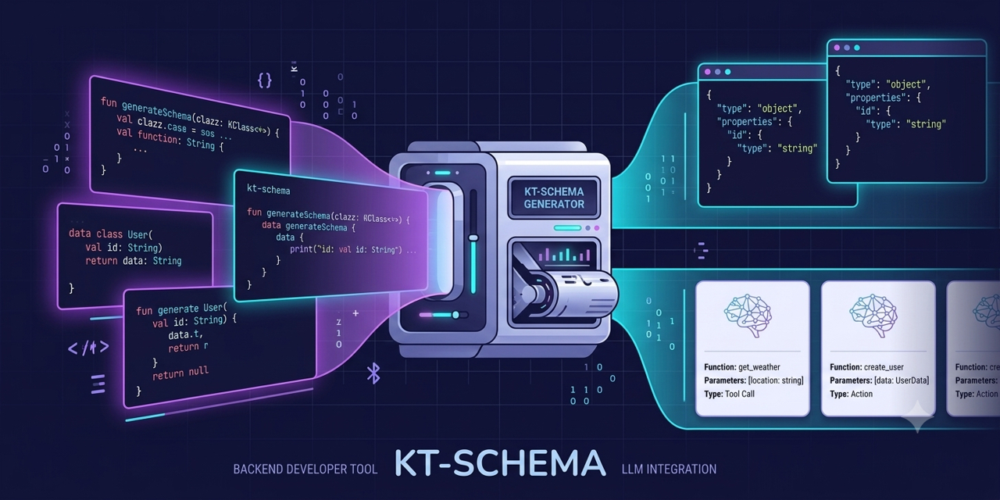

[](https://central.sonatype.com/search?q=me.kpavlov.kt.schema%2Fkt-schema-*)
[](https://github.com/kpavlov/kt-schema/actions/workflows/build.yml)
[](https://kpavlov.github.io/kt-schema/)
[](https://kpavlov.github.io/kt-schema/api/)
[](https://github.com/kpavlov/kt-schema/tree/main/examples)
[](LICENSE)
[](http://kotlinlang.org)
[](https://kotlinlang.org/docs/multiplatform.html)
[](http://java.com)
[](https://deepwiki.com/kpavlov/kt-schema)
<div style="align-content: center">
  
</div>

# KT-Schema

**Generate JSON schemas and LLM function calling schemas from Java and Kotlin code — including classes you don't own.**

Full documentation lives at **[kpavlov.github.io/kt-schema](https://kpavlov.github.io/kt-schema/)**. This README
is the short tour; each topic below links to its guide.

- [Documentation Index](docs/README.md)
- [KSP Configuration Guide](docs/ksp.md)
- [Java Annotation Processor Guide](docs/apt.md) — including Jackson-backed Java enum names
- [Serialization-Based Schema Generation](docs/serializable.md)
- [Runtime Reflection](docs/reflection.md) — any JVM class, including third-party types
- [Generated Schemas](docs/generated.md) — worked examples and the `@Schema`/`@Description` reference
- [Function Calling](docs/function-calling.md) — LLM tool schemas at runtime or compile time
- [Validation Constraints](docs/constraints.md) — Jakarta Bean Validation annotations and built-in type ranges
- [Configuration](docs/configuration.md) — schema flavours and annotation detection
- [JSON Schema DSL](docs/dsl.md)
- [Project Architecture](docs/architecture.md)

## Key Features

**Generation Modes:**

- **Compile-time (Java APT)**: Zero runtime overhead for plain Java records, classes, interfaces and enums — no Kotlin
  required in your code
- **Compile-time (KSP)**: Zero runtime overhead, multiplatform, for your annotated Kotlin classes
- **Runtime (Reflection)**: JVM-only, for any class including third-party libraries
- **Runtime (SerialDescriptor)**: Kotlin serializable classes, including open polymorphism via `SerializersModule`

**LLM Integration:**

- Tool definitions for OpenAI, Anthropic and MCP from Kotlin functions
- Strict mode output: all parameters required, `additionalProperties: false`, `null` unions for optional values
- Function name and description extraction

**Flexible Annotation Support:**

- Recognizes `@Description`, `@LLMDescription`, `@JsonPropertyDescription`, `@P`, and more
- Recognizes KDoc (KSP compile-time only)
- Works with annotations from Jackson, LangChain4j, Koog without code changes

**Comprehensive Type Support:**

- **Enums, collections, maps, nested objects, nullability, generics** (with star-projection)
- **Polymorphic hierarchies** — sealed classes and open polymorphism (via `SerializersModule`) with automatic `oneOf`
  generation and discriminator field
- **Union types** for nullable parameters (`["string", "null"]`)
- **Type constraints** (min/max, patterns, formats) from Jakarta Bean Validation annotations, built-in types and the
  JSON Schema DSL
- **Default values** (compile-time: tracked but not extracted; runtime: fully extracted)
- **`$ref`/`$defs` deduplication**: named types appear once in `$defs` and are referenced everywhere via `$ref`
- **`kotlin.Any`**: maps to the empty schema `{}` (accepts any JSON value)

**Developer Experience:**

- Type-safe Kotlin DSL for programmatic schema construction
- Works everywhere: JVM, JS, iOS, macOS, Wasm

> [!TIP]
> **Need to build JSON Schemas manually?** The [**kt-schema-json**](kt-schema-json) module provides type-safe
> Kotlin models and DSL compliant with [JSON Schema Draft 2020-12](https://json-schema.org/draft/2020-12/schema), with
> support for polymorphism, discriminators, and type-safe enums. See the [JSON Schema DSL guide](docs/dsl.md).

**Table of contents:**
<!--- TOC -->

* [Why kt-schema?](#why-kt-schema?)
  * [When to Use](#when-to-use)
* [Choosing Your Approach](#choosing-your-approach)
* [Quick Start](#quick-start)
  * [Annotate Your Models](#annotate-your-models)
  * [Configuration](#configuration)
    * [Quick Setup](#quick-setup)
    * [Schema configuration](#schema-configuration)
* [Runtime schema generation](#runtime-schema-generation)
* [What Gets Generated](#what-gets-generated)
* [Function calling schema generation for LLMs](#function-calling-schema-generation-for-llms)
* [Multi-Framework Annotation Support](#multi-framework-annotation-support)
* [JSON Schema DSL](#json-schema-dsl)
* [Building and Contributing](#building-and-contributing)
* [Requirements](#requirements)
* [Code of Conduct](#code-of-conduct)
* [License](#license)
  * [Attribution](#attribution)

<!--- END -->

## Why kt-schema?

This library solves three key challenges:

1. **🤖 LLM Function Calling Integration**: Generate tool definitions for OpenAI, Anthropic and MCP directly from
   Kotlin functions, with proper type definitions and descriptions
2. **📦 Third-Party Class Support**: Create schemas for library classes without modifying their source code (Spring
   entities, Ktor models, etc.)
3. **🔄 Multi-Framework Compatibility**: Works with existing annotations from Jackson, LangChain4j, Koog, and more — no
   code changes needed

### When to Use

* 🤖 Building LLM-powered applications with structured function calling (OpenAI, Anthropic, MCP)
* 👽 Need schemas for third-party library classes you cannot modify
* ✅ Already using `@Description`-like annotations from other frameworks
* 👌 Want zero runtime overhead with compile-time generation (multiplatform support)
* ☕️ Need dynamic schema generation at runtime via reflection (JVM)

## Choosing Your Approach

|                                   | 🔧 [KSP Processor](docs/ksp.md) | ☕ [Java APT](docs/apt.md) | 📦 [Serialization-based](docs/serializable.md) | 🔍 [Runtime Reflection](#runtime-schema-generation) |
|:----------------------------------|:-------------------------------:|:--------------------------:|:----------------------------------------------:|:---------------------------------------------------:|
| **Platforms**                     |       JVM + Multiplatform       |          JVM only          |              JVM + Multiplatform               |                      JVM only                       |
| **When generated**                |          Compile-time           |        Compile-time        |                    Runtime                     |                       Runtime                       |
| **Requires annotation processor** |            Yes (KSP)            |         Yes (APT)          |                       No                       |                         No                          |
| **Class must be `@Serializable`** |               No                |             No             |                      Yes                       |                         No                          |
| **Annotate class with `@Schema`** |            Required             |       Not required¹        |                  Not required                  |                    Not required                     |
| **KDoc extracted to description** |               ✅                |             ❌             |                       ❌                       |                         ❌                          |
| **Extract default values**        |            Partial²             |          Partial²          |                       ❌                       |                         ✅                          |
| **Third-party classes**           |               ❌                |             ❌             |           ✅ (only `@Serializable`)            |                  ✅ any JVM class                   |

¹ with the `rootPackage` option — see [Java Annotation Processor Guide](docs/apt.md#triggering-schema-generation).

² Jackson's `@JsonEnumDefaultValue` becomes the enum's `default`. Kotlin/Java default-value expressions can't be
evaluated at compile time, so no property `default` is emitted — see
[Multi-Framework Annotation Support](https://kpavlov.github.io/kt-schema/configuration/#multi-framework-annotation-support).

- **[Pick KSP](docs/ksp.md)** when you own the classes, want zero runtime overhead, and target Multiplatform or need
  KDoc
  in your schema.

- **[Pick Java APT](docs/apt.md)** when your code is plain Java (no Kotlin) and you want zero runtime overhead.
  Supports Java records, classes, interfaces and enums.

- **[Pick Serialization-based](docs/serializable.md)** when your classes are already `@Serializable` and you need
  Multiplatform support without a build-time processor.

- **[Pick Reflection](#runtime-schema-generation)** when you need JVM-only runtime generation for third-party classes,
  or
  need to extract data class default values. Works equally well for `@Serializable` classes on JVM.

## Quick Start

Refer to the example projects [here](./examples).

### Annotate Your Models

<!--- CLEAR -->
<!--- INCLUDE
import me.kpavlov.kt.schema.Schema
import me.kpavlov.kt.schema.Description
import jakarta.validation.constraints.Pattern
import jakarta.validation.constraints.Size
-->

```kotlin
/**
 * A postal address for deliveries and billing.
 */
@Schema
data class Address(
    @Description("Street address, including house number") @Size(max = 120) val street: String,
    @Description("City or town name") @Size(min = 1, max = 80) val city: String,
    @Description("Postal or ZIP code") @Pattern(regexp = "[0-9]{5}") val zipCode: String,
    @Description("Two-letter ISO country code; defaults to US") @Pattern(regexp = "[A-Z]{2}") val country: String = "US",
)
```

<!--- KNIT example-knit-readme-01.kt --> 

<details>
<summary>Generated JSON schema (KSP, default <code>strict</code> config)</summary>

```json
{
    "$schema": "https://json-schema.org/draft/2020-12/schema",
    "$id": "com.example.Address",
    "description": "A postal address for deliveries and billing.",
    "type": "object",
    "properties": {
        "street": {
            "type": "string",
            "description": "Street address, including house number",
            "maxLength": 120
        },
        "city": {
            "type": "string",
            "description": "City or town name",
            "minLength": 1,
            "maxLength": 80
        },
        "zipCode": {
            "type": "string",
            "description": "Postal or ZIP code",
            "pattern": "[0-9]{5}"
        },
        "country": {
            "type": "string",
            "description": "Two-letter ISO country code; defaults to US",
            "pattern": "[A-Z]{2}"
        }
    },
    "additionalProperties": false,
    "required": [
        "street",
        "city",
        "zipCode",
        "country"
    ]
}
```

</details>

> **Note:** KDoc comments on classes can also be used as descriptions. Jakarta Bean Validation annotations such as
> `@Size` and `@Pattern` become `maxLength`, `minLength` and `pattern` — see
> [Validation Constraints](docs/constraints.md).

### Configuration

#### Quick Setup

Add the Google KSP plugin and the processor dependency:

```kotlin
// Multiplatform (KMP)
plugins {
    kotlin("multiplatform")
    id("com.google.devtools.ksp") version "<ksp-version>"
}

dependencies {
    add("kspCommonMainMetadata", "me.kpavlov.kt.schema:kt-schema-ksp:<version>")
    implementation("me.kpavlov.kt.schema:kt-schema-annotations:<version>")
}

kotlin {
    sourceSets.commonMain.kotlin.srcDir("build/generated/ksp/metadata/commonMain/kotlin")
}
```

For JVM-only projects and full configuration options, see the [KSP Configuration Guide](docs/ksp.md).

#### Schema configuration

The `me.kpavlov.kt.schema.config` processor option selects the schema flavour (`strict`, `lenient`, `openapi` or your
own `JsonSchemaConfig`) for both KSP and the Java annotation processor. See
[Configuration](docs/configuration.md#schema-configuration).

## Runtime schema generation

For JVM-only scenarios with classes you don't own or can't annotate, `ReflectionClassJsonSchemaGenerator` builds the
schema from Kotlin reflection at runtime. Add `me.kpavlov.kt.schema:kt-schema-generator-json:<version>` and call
`generateSchema(User::class)`. See the [Runtime Reflection guide](docs/reflection.md).

## What Gets Generated

Schemas follow JSON Schema Draft 2020-12: `$id`, `$defs`/`$ref` deduplication, `["string", "null"]` unions for
nullable types, `oneOf` with a discriminator for sealed hierarchies, and `description` from `@Description` or KDoc.
Worked examples for data classes, enums, nested objects, generics and sealed classes, plus the `@Schema` and
`@Description` reference, are in the [Generated Schemas guide](docs/generated.md).

## Function calling schema generation for LLMs

`ReflectionFunctionCallingSchemaGenerator` (runtime) and `@Schema` on functions (KSP, compile time) produce tool
definitions in the OpenAI Responses API shape, with `strict: true`, parameter descriptions and `["string", "null"]`
unions for nullable parameters. The same `parameters` object serves as Anthropic's `input_schema` and MCP's
`inputSchema`. See the [Function Calling guide](docs/function-calling.md).

## Multi-Framework Annotation Support

kt-schema recognizes `@Description`, Koog's `@LLMDescription`, Jackson's `@JsonPropertyDescription`/
`@JsonClassDescription`, LangChain4j's `@P`, plus Jackson/kotlinx.serialization name overrides, ignore markers and
discriminators, so existing annotated classes need no changes. Detection is configurable through
`kt-schema.properties`. See [Configuration](docs/configuration.md#multi-framework-annotation-support).

## JSON Schema DSL

For manual schema construction, the [**kt-schema-json**](kt-schema-json) module provides type-safe models and a DSL
for [JSON Schema Draft 2020-12](https://json-schema.org/draft/2020-12/schema). See the
[JSON Schema DSL guide](docs/dsl.md) and [kt-schema-json/README.md](kt-schema-json/README.md).

## Building and Contributing

For build instructions, development setup, and contribution guidelines, see [CONTRIBUTING.md](CONTRIBUTING.md).

## Requirements

- Kotlin 2.2+
- KSP 2.3.1+ for compile-time KSP generation (earlier KSP2 builds report wrong annotation-argument origins, so
  `@Schema` parameters can be mistaken for defaults)
- _kotlinx-serialization-json_ for JsonObject support

Tip: If you use `@Description` on primary constructor parameters, enable
`-Xannotation-default-target=param-property` in Kotlin compiler options so the description applies to the backing
property.

## Code of Conduct

This project and the corresponding community are governed by the
[Contributor Covenant Code of Conduct](CODE_OF_CONDUCT.md). Please make
sure you read and adhere to it.

## License

This project is licensed under the Apache License 2.0 - see the [LICENSE](LICENSE) file for details.

### Attribution

**kt-schema** is an independently maintained fork of [kotlinx.schema](https://github.com/Kotlin/kotlinx-schema).
Konstantin Pavlov originally started the work while at JetBrains.

This project contains modified and unmodified portions of the original work.
Notable changes include renaming the Kotlin packages from `kotlinx.schema` to `me.kpavlov.kt.schema`, renaming Maven
coordinates from `org.jetbrains.kotlinx` to `me.kpavlov`, and further independent development.

See the [LICENSE](LICENSE) and [NOTICE](NOTICE) files for licensing and attribution information.

**kt-schema** is an independent project and is not affiliated with, endorsed by, or sponsored by JetBrains.
"Kotlin" and "JetBrains" are trademarks of their respective owners.
